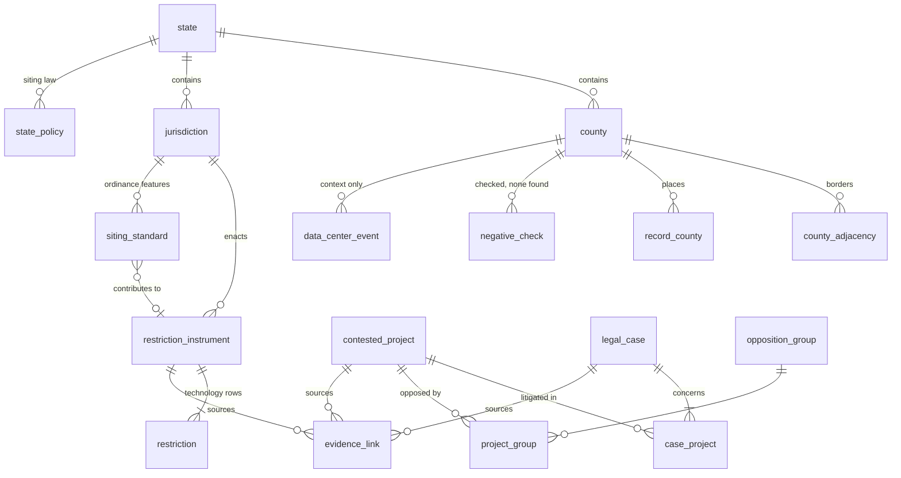

# National database and dashboard: design

**Status:** 2026-10-13. Phases 1 to 5 are built, and phase 6 (coverage and verification, section 10) is under way: the database (`db/`, `scripts/build_database.py`, `tests/test_build_database.py`), its publication by the Build dashboard data workflow, and the dashboard (`national-dashboard.html`: national, state, county, explorer, record, coverage, data and SQL views; `tests/ui/national.spec.js`, `tests/ui/explore.spec.js`). The three old pages redirect to it. Phase 5 added Census GEOIDs for every named jurisdiction, a timeline that uses NREL's ordinance years, and the headline figures from build to build (section 9). State siting law arrived separately (`state_policy`, 122 rows).

This document designs one national database for everything the pipeline publishes, and one dashboard on top of it, to replace the four pages that read `data/processed/` today.

---

## 1. Where things stand

The pipeline already does the hard part. Seeds and review files go through `build_seed_outputs.py`, the QC gate and `classify.py`, and come out as CSV and JSON in `data/processed/`. `headline_metrics.json` holds the numbers to quote.

What it does not have is one place where the entities meet:

| Gap | Today |
|---|---|
| No joins across entities | A county's restrictions, projects, cases, NREL standards, data center events, neighbors and negative checks come together only in `site_profile.py`, a command-line tool. |
| Pages download everything | Each page fetches whole JSON files: `restrictions.json` is 8.2 MB and `siting_standards.json` is 14.1 MB. |
| Four overlapping pages | `index.html`, `dashboard.html`, `renewable-opposition-map.html` and `map-audit.html` each filter and count the same records their own way. |
| No query interface | A researcher who wants "severe solar restrictions in counties adjacent to a blocked project" has to write Python against the CSVs. |
| Coverage is a footnote | `headline_metrics.md` says 1,740 counties have never been examined, but no page shows which ones. |

## 2. Goals and non-goals

**Goals**

1. **One national database.** Every published entity in one queryable file, keyed by instrument and by county.
2. **One dashboard** that goes nation → state → county → record, plus a table explorer and downloads.
3. **The same numbers everywhere.** `headline_metrics.json` stays the authority. The database checks itself against it on every build and refuses to write if any number differs.
4. **Coverage and evidence on every view.** Every count shows its verified share beside it. The map tells apart a county with records, a county someone checked and found nothing in, and a county nobody has looked at.
5. **No server.** Static files on GitHub Pages, as now. No running cost, no credentials, nothing to keep up.

**Non-goals**

- Editing in the database. Review stays in `data/review/*.csv` and the promotion gates; the database is rebuilt from scratch every time.
- Scores or predictions on the dashboard. Like site profiles, it describes what is recorded. Internal models are planned separately in `predictive_foundation_design.md` (approved 2026-10-15); none of their output reaches a page without a further decision.
- Folding data center events into renewable counts. They appear as county context only, as in profiles.
- Publishing local knowledge. `local_knowledge.csv` never enters the database.

## 3. Architecture

```
data/seed/*.csv, data/review/*.csv
        │  build_seed_outputs.py  (QC gate, classify, promotion; unchanged)
        ▼
data/processed/*.csv, *.json, headline_metrics.json      ← source of truth
        │  build_database.py  (db/schema.sql, load.sql, views.sql; parity check)
        ▼
data/db/renewable_opposition.duckdb   +   data/db/parquet/<table>.parquet, state_summary.json,
(built locally, never committed)           county_summary.json, state/<ST>.json
                                           (committed by the Build dashboard data workflow)
        │
        ├── national-dashboard.html: national, state, county views (summaries + state files)
        ├── explorer and record pages (all state files, plain JavaScript)
        ├── SQL console (DuckDB-WASM over the Parquet, loaded only there)
        └── downloads (DuckDB file, Parquet, the existing CSVs)
```

### Decision: DuckDB and Parquet, queried in the browser

| Option | For | Against |
|---|---|---|
| **DuckDB file + Parquet + DuckDB-WASM** (chosen) | One file researchers can open; Parquet is the standard open format; the whole database is **2.2 MB** as Parquet against 22 MB of JSON today; the browser runs real SQL, so the dashboard does not need a JSON file per view; no server. The session hook already installs the DuckDB CLI. | The WASM bundle is several megabytes, so it must load after first paint (see below). |
| Postgres / PostGIS (hosted) | Multi-user writes, a live API, spatial queries. | Needs a server, credentials, a sync job and a bill. The data has no live writers: everything goes through review CSVs and a build. Revisit only if that changes. |
| SQLite + sql.js | Small, universal, Datasette-compatible. | No Parquet; slower for the group-by work the dashboard does. A SQLite export is a few lines if someone needs one. |

**First paint.** The national view must not wait for the WASM engine. The build also writes two small JSON files, `data/db/state_summary.json` (52 rows, 3 KB) and `county_summary.json` (3,222 rows, 250 KB), from the views below, and the landing page draws from those plus `headline_metrics.json`.

**Revised 2026-10-10: DuckDB-WASM is for the explorer only.** Measured in phase 3, the engine is 35.7 MB (`duckdb-eh.wasm` 1.29.0), about 7 MB gzipped, before any Parquet. Loading that to open one county would cost a phone reader far more than the county's data. So the build writes one detail file per state, `data/db/state/<ST>.json`, from the same database with the same queries every build: the state's restrictions, projects, cases, siting standards (summarized per jurisdiction and technology), data center events, negative checks and county adjacency. The largest, New York, is 800 KB raw and 84 KB gzipped as GitHub Pages serves it. The state and county views read only that file. DuckDB-WASM waits for phase 4's explorer and SQL console, where arbitrary queries are the point, and loads only when someone opens them.

**Revised again 2026-10-12: only the SQL console uses DuckDB-WASM.** The explorer's filters (state, technology, type, severity, status, scope, source, verification, text) need no SQL, and the 52 state files already hold every record: about 1.1 MB gzipped together (8.1 MB raw), a sixth of the engine alone. So the explorer and the record pages read the state files in plain JavaScript (a record's state comes from `data/db/record_index.json`), and the engine loads only on `#/sql`. There it fetches every Parquet file in `data/db/manifest.json` and exposes each table and view by name. DuckDB-WASM reads Parquet through an extension it fetches from extensions.duckdb.org at run time (CORS open); the offline UI tests serve a copy pinned by SHA-256 (`tests/ui/fetch_duckdb_extension.sh`). The page's import map pins `apache-arrow`, `tslib` and `flatbuffers` to the versions `@duckdb/duckdb-wasm` 1.29.0 resolves to.

## 4. Data model

The schema is in `db/schema.sql`. Two keys run through everything:

- **`instrument_id`**, the counting unit: one ordinance, moratorium, project or case, however many technology rows it has. Every count in every view is a count of these.
- **`county_fips`**, the geographic spine: 2024 county FIPS, with `record_county` holding every county a record touches.



| Table | Grain | Rows now | Notes |
|---|---|---:|---|
| `state` | state, DC, PR | 52 | |
| `county` | 2024 county | 3,222 | `in_coverage_universe` excludes Puerto Rico, as `headline_metrics` does (3,144). |
| `county_adjacency` | county pair | 17,908 | from `geo.neighbors`, across state lines |
| `jurisdiction` | local government | 2,485 | matched on `common.jurisdiction_key`. A match key, not an authority file: records and standards also carry a Census `geoid` (section 9). |
| `government` | Census government a record names | 2,522 | `geoid` (2 digits a state, 5 a county, 7 a place, 10 a county subdivision), kind, county, Census name, FUNCSTAT; from `data/census_governments_2024.csv` and the county table |
| `jurisdiction_match` | state × type × name × counties | 2,796 | how each named jurisdiction got its GEOID, or why it got none (section 9) |
| `headline_history` | day | 6 | the headline figures on each day a build changed them (`data/snapshots/headline_history.csv`) |
| `restriction_instrument` | instrument | 3,423 | technologies and types as arrays; severity is the highest of its rows; verification is the weakest |
| `restriction` | instrument × technology | 3,625 | the published rows, typed |
| `contested_project` | project | 576 | adds `outcome_class` (blocked, advanced, restricted, pending, needs_review) and `outcome_confirmed` |
| `legal_case` / `case_project` | case / case × project | 38 / 39 | one case can concern two projects |
| `siting_standard` | jurisdiction × technology × feature | 23,778 | NREL 2025, with `restriction_instrument_id` where a feature restricts |
| `state_policy` | state × policy | 122 | state siting law |
| `record_county` | record × county | 27,738 | from `county_fips_all`, with the placement method |
| `evidence_link` | record × role × URL | 6,669 | every URL behind a record, with its job (compiled source, primary source, ordinance, outcome evidence, placement, court record) and how it was seen (opened, archived, snippet) |
| `source_document` | source document | 52 | `sources.csv` as is |
| `opposition_group` / `project_group` | group / project × group | 802 / 30 | |
| `negative_check` | check | 1 | with its `grade`, evidence `classes`, `recheck_by`, `drafted_by`, `governments_checked`, and `held` (drafted, not yet reviewed: counted nowhere) |
| `county_pending_review` | county | 3 | how many pending review-queue candidates name the county (`site_profile.pending_for`): the count only, never the candidates |
| `data_center_event` | event | 2,252 | from `data/reference/`, never counted |
| `build_info` | key/value | | build time, commit, the `headline_metrics.json` it was checked against |

### Views (`db/views.sql`)

- `v_headline_restrictions`, `v_headline_by_source`, `v_county_coverage_totals`: the headline numbers, recomputed. `build_database.py` compares them with `headline_metrics.json` field by field and stops on any difference.
- `v_county_summary`: one row per county with restriction, project, verification, moratorium and data center counts, and a **`coverage_status`**:
  - `has_records`: at least one published record placed in the county (1,403 now)
  - `checked_none`: a documented negative check and no record (1)
  - `not_examined`: neither; nothing is known either way (1,740)
- `v_state_summary`: the same per state, plus case and state-policy counts and the three coverage counts.
- `v_restrictions_by_month`: enactments by month, with an undated row per scope, because only 194 of 3,423 instruments carry an enactment date. All 2,393 NREL instruments are undated; NREL's `ordinance_year` (2001 to 2025, on 1,247 jurisdictions) can fill part of that.
- `v_restrictions_by_year`: instruments by year and by how the year is known (`basis`): `enacted` (the enactment date), `ordinance_year` (NREL's, for an instrument built from NREL standards), `year_reported` (a year in the source's date text, Sabin's editions) or `undated`. The dashboard's timeline (section 9).
- `v_geoid_coverage`: named jurisdictions by kind and match method, matched or not.

### Rules the database keeps

- It is derived; nothing in it is hand-edited. The `.duckdb` file is in `.gitignore`. The Parquet export and the two summaries are committed, and their bytes depend only on the data (rows sorted, build time and commit left out of `build_info.parquet`), so a build that changes no data commits nothing.
- It counts instruments, never rows, and keeps `multi_sector_data_centers` beside the renewables figure, never inside it.
- It publishes nothing the build holds back: no quarantine rows, no review candidates, no local knowledge. The one exception is a number: `county_pending_review` says how many candidates name a county, with nothing about them (decision 2 below).
- It aggregates deterministically (`min()`, never `any_value()`; every list ordered), so the published files are byte-identical across builds. The siting-standard summaries group by the jurisdiction's own name as well as its match key, because the key folds "Binghamton City" and "Binghamton Town" into one.

## 5. Dashboard design

### Principles

1. **Every count carries its evidence.** "1,362 severe restrictions · 69 verified against the instrument" on the same line, never the first number alone.
2. **Three-state coverage on every map.** Records shaded by the chosen metric; "checked, none found" as a light fill with an outline; "not examined" hatched. An unexamined county is never drawn as a zero.
3. **Every number opens its records**, and every record shows its sources with how each was seen ("verified", "source located, not yet read", "compiled report only").
4. **The URL is the state.** Every view, filter and selection lives in the hash, so any view can be linked and the site stays static.
5. **One codebase.** Plain JavaScript modules and no build step, as the repository does now; `basemap.js` and `counties_2024.topojson` are reused.

### Views

| Route | View | Contents |
|---|---|---|
| `#/` | **National** (built) | headline tiles from `headline_metrics.json`, counties examined among them; county map with a metric switch (severe restrictions, all restrictions, active moratoria, contested projects, blocked projects, coverage); sortable state table; records and verification by source; the restrictions timeline by year and how each year is known; the headline figures from build to build (section 9). |
| `#/state/IA` | **State** (built) | state framework (`state_policy`; "not yet researched" while empty); the state's county map; sortable county table; restrictions (multi-sector ones listed apart), projects and cases |
| `#/county/19113` | **County** (built) | coverage banner (records, checked with nothing found, or not examined); state framework; restrictions and projects in the county with their evidence and sources; the count of review candidates naming it, if any; NREL standards; adjacent counties with a map; data center activity (context, not counted) |
| `#/restriction/<id>`, `#/project/<id>`, `#/case/<id>` | **Record** (built) | every field; the instrument's technology rows; where it is placed and how (county named, coordinates, a town in one county, reviewer override); every source with how it was seen; linked cases or projects; a permalink |
| `#/explore/<entity>` | **Explorer** (built) | restrictions, projects or cases, one row per instrument, with filters for state, scope, technology, type, severity, status, verification, source and text; the filters live in the URL; CSV export of the filtered rows (cells that would run as spreadsheet formulas are escaped) |
| `#/coverage` | **Coverage and evidence** (built) | counties examined, checked with nothing found, or not examined; the share not examined by state; records and verification by source; each review worklist's size, never its rows (`data/db/worklists.json`) |
| `#/data` | **Data** (built) | every Parquet file with rows and size (`data/db/manifest.json`); example queries that open in the SQL console; a data dictionary parsed from `db/schema.sql`; sources and licenses |
| `#/sql` | **SQL console** (built) | DuckDB-WASM over every table and view; results table and CSV; the query lives in the URL |

### National view, wireframe

```
┌───────────────────────────────────────────────────────────────────────────┐
│ Renewable Opposition · National                       [State ▾] [Search]  │
├───────────────────────────────────────────────────────────────────────────┤
│ Restrictions      Severe            Contested projects   Cases             │
│ 3,340             1,362             576                  38                │
│ 69 verified;      severity 3 or 4   235 blocked,         38 with a court   │
│ +83 cover DCs     of 3,340          70 confirmed         record            │
├─────────────────────────────────────────────────┬─────────────────────────┤
│ Map: [Severe restrictions ▾]  [Solar][Wind][BESS]│ States                  │
│                                                  │ NY  537  271 severe     │
│        (county choropleth, 3 coverage states)    │ PA  474  164 severe     │
│                                                  │ MI  300   85 severe     │
│ ▒ not examined (1,740)  □ checked, none (1)      │ ...                     │
│ ■ records (1,403)                                │                         │
├─────────────────────────────────────────────────┴─────────────────────────┤
│ Instruments (verified) by source │ Enacted by month (194 dated, 3,229 undated)│
│ Sabin 2026   ███ 756 (1)         │ ▁▂▂▃▅▆█▇                                │
│ NREL         ████████ 2,393 (27) │                                         │
│ Moratorium N █ 210 (43)          │                                         │
└───────────────────────────────┴────────────────────────────────────────────┘
```

### County view, wireframe

Placeholders in angle brackets; the layout, not the data, is the point.

```
┌───────────────────────────────────────────────────────────────────────────┐
│ ← State   Example County, ST (00000)       coverage: has records          │
├───────────────────────────────────────────────────────────────────────────┤
│ State framework       state siting law not yet researched                 │
├───────────────────────────────────────────────────────────────────────────┤
│ In the county                                                             │
│  Restriction  <type>, <status>, severity <n>     verified | located | not │
│  Project      <name>, <technology>, <outcome>    read source | report only│
├──────────────────────────────────────┬────────────────────────────────────┤
│ Adjacent counties (mini map)         │ NREL siting standards              │
│  <Neighbor A> · 2 restrictions       │  <technology>: <feature> <value>   │
│  <Neighbor B> · not examined         │  NREL's reading, unverified        │
├──────────────────────────────────────┴────────────────────────────────────┤
│ Data center activity (context, not counted) · Groups active nearby        │
└───────────────────────────────────────────────────────────────────────────┘
```

### What happens to the current pages

Done 2026-10-12 (decided 2026-10-10): `index.html` and `renewable-opposition-map.html` redirect to `national-dashboard.html#/`, and `dashboard.html` to `#/explore/restrictions`, so old links keep working (`tests/ui/pages.spec.js` checks each). `map-audit.html` stays as the internal geography audit, the one page still on Leaflet, `basemap.js` and `processed-data.js`. What the retired map did that the dashboard does not: point markers on a basemap. The county is the unit here, and every record links to its county. `tests/ui/choropleth.spec.js` tested the retired map's Leaflet county layer; its checks that apply to the new map (every county the data names is shaded, a state view draws all its counties from the local TopoJSON, a geometry failure says so and leaves every table) moved to `tests/ui/national.spec.js`.

### Map encoding

The county map shades by fixed classes (0, 1, 2–4, 5–9, 10 or more) so a shade means the same count on every view. The ramp is the teal of the existing county choropleth, re-stepped and checked with the dataviz palette validator against both page surfaces. "Not examined" is a neutral grey and "examined, none recorded" is near-white; with the first teal step, the three pass the all-pairs separation checks (colour-blind and normal vision) in light and dark, so an unexamined county never reads as a zero. Every value on a map is also in a table on the same view.

## 6. Phased plan

| Phase | Scope | Done when |
|---|---|---|
| **1. Database** (done) | `db/schema.sql`, `load.sql`, `views.sql`; `scripts/build_database.py`; parity with `headline_metrics.json`; tests | built, tested, parity holds |
| **2. Publish** (done) | the Build dashboard data workflow runs `build_database.py --publish`, which writes `data/db/parquet/` (25 files, about 2.1 MB) and `data/db/state_summary.json` (3 KB) and `county_summary.json` (250 KB); the workflow commits them so GitHub Pages serves them | Parquet and summaries on the published site after each build |
| **3. Dashboard shell** (done) | `national-dashboard.html`: national, state and county views from the summaries and `data/db/state/<ST>.json`; Playwright tests (`tests/ui/national.spec.js`: figures equal the published files, unexamined counties drawn as such, axe, phone width) and the frontend smoke test | totals match `headline_metrics.json` on every view |
| **4. Explorer and records** (done) | explorer and record pages over the state files; SQL console on DuckDB-WASM; coverage view (worklist sizes only); data page; `data/db/record_index.json`, `worklists.json`, `manifest.json`; the three old pages redirect | the old pages retired; every view's counts match the published files |
| **5. Depth** (done) | Census GEOIDs for jurisdictions (places and county subdivisions) beside the match key; NREL `ordinance_year` on the timeline; build-to-build history in `data/snapshots/headline_history.csv` so the dashboard shows what changed. State siting law came in separately. | 99.1% of instruments and 99.9% of siting-standard rows carry a GEOID, the rest listed in `data/review/geoid_worklist.csv`; the timeline's years and its undated count add up to the headline figure |
| **6. Coverage and verification** (under way) | a county check anyone can repeat (`docs/COUNTY_CHECK.md`); negative checks held until a second reviewer signs them, graded by the kind of each source, due again after a year; `data/review/examination_worklist.csv`; examination progress on the dashboard; passes recorded in `docs/county_checks/` | every county examined: a published record or a reviewed negative check |

## 7. Decisions for Price

1. ~~**Where the Parquet lives.**~~ Decided 2026-10-09: committed in `data/db/parquet/`, served by GitHub Pages. The `.duckdb` file can go on a release when there is one.
2. ~~**What the public dashboard shows.**~~ Decided 2026-10-10: published records only, with the count of pending review candidates that name the county and no detail (`county_pending_review`).
3. ~~**Worklists on the public site.**~~ Decided 2026-10-10: the coverage view (phase 4) shows the worklists' sizes; the worklists stay in the repository.
4. ~~**Retiring the old pages.**~~ Decided 2026-10-10: redirect them once the new dashboard passes the smoke tests (phase 4, see above).

## 8. Building the database

```bash
python scripts/build_database.py                              # data/db/renewable_opposition.duckdb
python scripts/build_database.py --publish                    # also data/db/parquet/, the two summaries and data/db/state/
duckdb -readonly data/db/renewable_opposition.duckdb \
  -c "SELECT state_code, restrictions, severe_restrictions, counties_not_examined FROM v_state_summary ORDER BY restrictions DESC LIMIT 10"
```

The build reads only files the pipeline already publishes (and `data/reference/data_center_events.csv` and the county boundary file), takes about 15 seconds, and exits 1 without writing if any headline number differs from `headline_metrics.json`.

Negative checks come from `data/processed/negative_checks.csv`. `build_seed_outputs.py` writes it from every row it validated (held ones included), in the same run that writes `headline_metrics.json` from the rows not held. The database build never reads `data/review/negative_checks.csv`. A research branch that adds or deletes a check commits only the review file: `review_lint.py --lane review` fails a branch that changes a generated file. On that branch the processed copy and the metrics are still the ones main last built, so parity holds. After the merge, the Build dashboard data workflow rewrites both from the review file, then builds the database. `tests/test_build_database.py` builds the database from an edited review file to check this.

## 9. Phase 5: GEOIDs, the timeline and the history

### Census GEOIDs

`common.jurisdiction_key` folds "Binghamton City" and "Binghamton Town" into one key, though they are two governments. Each record and each NREL siting standard now also carries the Census GEOID of the government it names, so the two stay apart.

- `scripts/build_census_governments.py` writes `data/census_governments_2024.csv` from the Census 2024 Gazetteer (the files `build_place_index.py` reads): every incorporated place and county subdivision with a functioning government (FUNCSTAT A, B or C), 35,670 in all. CDPs, CCDs and other statistical areas are left out, because they are not governments. A place's county is the county containing its internal point.
- `scripts/geoid_match.py` matches one named jurisdiction, given its state, type and counties. It assigns a GEOID only when exactly one government fits on name, kind of government (when the record says it) and county (when the record has one). Two or more fits are `ambiguous`, none is `no_match`, and a single fit in another county is `county_differs`. Each narrow fallback has its own method name: another kind of government with the same name in the record's own county, a place over a county line, and a name that contains its kind ("Ponca City" is Census "Ponca City city"). The module docstring lists them all.
- `build_database.py` matches each distinct (state, type, name, counties) once and records the outcome in `jurisdiction_match`. Records without a GEOID go to `data/review/geoid_worklist.csv`, with the candidates' GEOIDs and names (30 rows now). The coverage view shows only its size.
- Coverage now: 3,393 of 3,424 instruments and 23,759 of 23,778 siting-standard rows.
- **Check against NREL's own codes.** NREL gives a 10-digit FIPS code for 1,267 municipal jurisdictions. 1,067 match exactly. 165 more name the same government under its other Census code (a city that is also a county subdivision, where the place code is preferred). The other 32 are NREL codes for CCDs, which are statistical areas rather than governments. 2 are left unmatched and 1 code is missing from the 2024 Gazetteer. The comparison found one error, "Rogers City", MI, which had been matched to Rogers township. It is fixed and covered by a test.

### Timeline

`v_restrictions_by_year` gives each renewables-only instrument one year and labels where that year comes from. Its enactment date comes first, then NREL's `ordinance_year`, then a year in the source's date text, and otherwise the instrument is counted as undated. The three kinds of year are different measurements, so the dashboard keeps them as separate colors in a stacked bar and states the undated count beside the chart rather than leaving it out: 120 enacted, 1,329 NREL ordinance years, 806 years from the report, 1,086 undated. A table under the chart gives every number.

### History

`scripts/headline_history.py` runs after each processed build (`scripts/run_pipeline.py build`). It adds the day's headline figures to `data/snapshots/headline_history.csv` when they differ from the last row, and replaces the row if a build already ran that day. `--backfill` rebuilt the file from the git history of `headline_metrics.json` and needs a full clone. A figure the metrics did not yet carry stays blank and is never set to zero. The national view shows four figures as step lines, a sentence naming what changed since the build before, and a table. A jump can mean a source was added, not that restrictions were passed: NREL's databases arrived on 2026-10-09.

## 10. Phase 6: coverage and verification

Most of the dashboard's map was unknown, not empty: 1,740 of 3,144 counties had no record and no documented search, and one county had a "checked, nothing found" result. Phase 6 makes examining a county a repeatable job and puts its progress on the dashboard.

- **The procedure.** `docs/COUNTY_CHECK.md` says which governments a check covers (the county and every municipality that zones), what it must search (each government's code and its minutes or the state docket, opened, plus a news search), what counts as a restriction (the rules every source already follows, applied only to land-use instruments that reach commercial, utility-scale or principal-use facilities), and how results are recorded: a restriction as a review-queue row a second reviewer confirms, a negative check as a row with its drafter and a different reviewer, anything else as a lead in the pass note.
- **Negative checks.** A drafted check with no reviewer is held and counts nowhere. Each source's leading kind (`code:`, `minutes:`, `web search:`) decides its evidence class, so a web search is never graded as primary law; the one earlier check, built from web searches, moved from grade A to B and is listed for a re-check. A check is due again a year after it ran (`recheck_by`).
- **The worklist.** `build_database.py` writes `data/review/examination_worklist.csv` from a temporary view (never exported): every unexamined county, plus held and below-grade-A checks, nearest-to-finished states first, with the state's siting authority, the county's Census local governments and its neighbors with restrictions. The dashboard shows its size.
- **The dashboard.** The coverage view shows states with every county examined, the share examined per state, and every negative check with its grade and re-check date; a county page states what its check covered; the map has a verified-restrictions metric.
- **Placement.** A reviewer's place override can list several counties, for an instrument that covers more than one (New York City's Zoning Resolution, in its five counties).

Passes are recorded in `docs/county_checks/`. The first (2026-10-13) covered the 20 unexamined counties in DC and nine nearly finished states.
